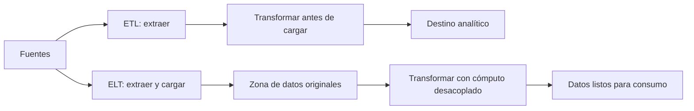
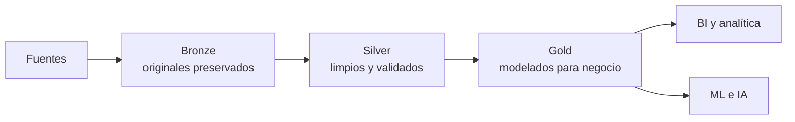
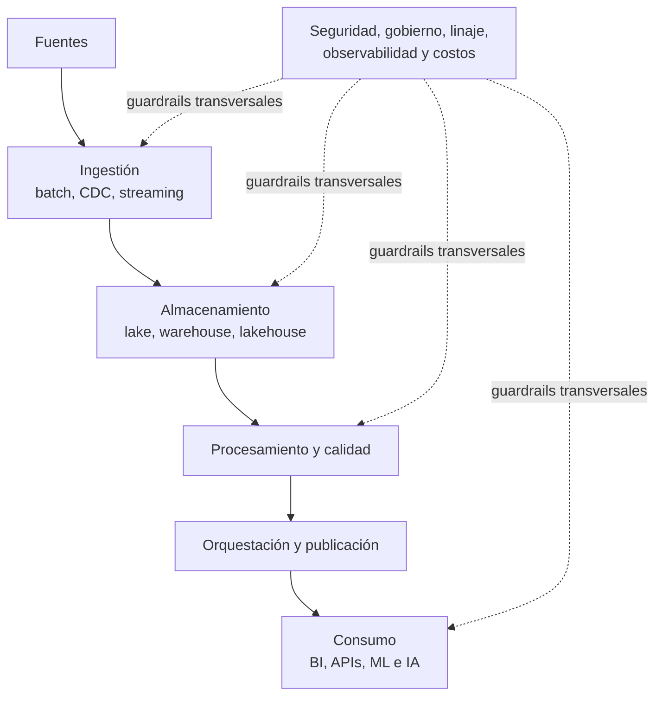

# Big Data Foundations: The Modern Data Ecosystem

## Resumen y conceptos clave

> Síntesis educativa en español de los conceptos principales de *Big Data Foundations: The Modern Data Ecosystem*. Organiza las ideas para facilitar su consulta y **no sustituye el curso ni reproduce su transcripción**. El material original no se incluye en este repositorio.

| | |
|---|---|
| **Tema** | Fundamentos de plataformas y arquitectura moderna de datos |
| **Audiencia** | Personas que estudian ingeniería, arquitectura o gobierno de datos |
| **Idioma de esta guía** | Español |
| **Curso de referencia** | *Big Data Foundations: The Modern Data Ecosystem* (Pluralsight) |
| **Siguiente paso** | [Roadmap: Arquitectura de Datos e IA](./Data-Architect-Roadmap.md) |

## En esta guía

- [Propósito y objetivos de aprendizaje](#propósito-y-objetivos-de-aprendizaje)
- [1. Evolución del stack moderno](#1-evolución-del-stack-moderno)
- [2. Capas de una plataforma de datos](#2-capas-de-una-plataforma-de-datos)
- [3. Ingestión y confiabilidad de pipelines](#3-ingestión-y-confiabilidad-de-pipelines)
- [4. Lake, warehouse y lakehouse](#4-lake-warehouse-y-lakehouse)
- [5. Motores, herramientas y ecosistemas](#5-motores-herramientas-y-ecosistemas)
- [6. Patrones organizativos y gobierno](#6-patrones-organizativos-y-gobierno)
- [7. Trade-offs de arquitectura](#7-trade-offs-de-arquitectura)
- [8. Tendencias: IA, RAG y automatización](#8-tendencias-ia-rag-y-automatización)
- [Lista de ideas clave](#lista-de-ideas-clave)
- [Continuar la ruta](#continuar-la-ruta)

## Propósito y objetivos de aprendizaje

El curso presenta el ecosistema moderno de datos y explica cómo diseñar flujos de extremo a extremo, seleccionar componentes para una plataforma de Big Data y tomar decisiones de arquitectura que equilibren requisitos de negocio, escalabilidad, gobierno, operación y costo.

Al terminar esta lectura, deberías poder:

- Explicar por qué la nube favoreció la separación entre almacenamiento y cómputo, y el uso de ELT.
- Describir las capas de una plataforma de datos y el papel de sus controles transversales.
- Comparar data lake, data warehouse y lakehouse según sus necesidades y compromisos.
- Identificar prácticas de confiabilidad: contratos, validación, idempotencia, orquestación y observabilidad.
- Reconocer trade-offs de herramientas, modelos organizativos, gobierno, seguridad y costo.
- Explicar cómo RAG, búsqueda vectorial y capas semánticas amplían la plataforma para IA.

**Idea central:** la arquitectura de datos no consiste en elegir una herramienta aislada. Se trata de conectar fuentes, ingestión, almacenamiento, procesamiento, orquestación y consumo, incorporando seguridad, gobierno y confianza en todas las capas.

## 1. Evolución del stack moderno

### De ETL a ELT

En el patrón tradicional **ETL** (*Extract, Transform, Load*), los datos se transforman antes de cargarse al destino analítico. En **ELT** (*Extract, Load, Transform*), primero se cargan en una plataforma escalable y luego se transforman allí. La elección depende de los requisitos; ELT no es automáticamente mejor para todos los casos.

La nube facilitó este cambio mediante almacenamiento de objetos de bajo costo y la separación entre almacenamiento y cómputo. Así es posible conservar datos originales, reprocesarlos con nuevas reglas y escalar motores de cómputo de manera independiente.

### Medallion

La arquitectura **medallion** propone refinar gradualmente los datos:

- **Bronze:** datos recibidos en formato cercano al original, preservados para auditoría y reproceso.
- **Silver:** datos depurados, validados, deduplicados y conformados.
- **Gold:** conjuntos curados para métricas, analítica y consumidores de negocio.

No es un producto ni una obligación universal: es una forma de organizar zonas y responsabilidades de transformación.

## 2. Capas de una plataforma de datos

Una plataforma coordina capas con responsabilidades distintas:

1. **Fuentes:** aplicaciones, bases de datos, archivos, sensores y eventos.
2. **Ingestión:** mueve datos por cargas batch, CDC o streaming.
3. **Almacenamiento:** mantiene datos crudos y curados en lakes, warehouses o lakehouses.
4. **Procesamiento:** limpia, valida, transforma, integra y agrega datos.
5. **Orquestación:** ordena ejecuciones, dependencias, reintentos y alertas.
6. **Consumo:** entrega datos a BI, analistas, aplicaciones, ciencia de datos y modelos.

La seguridad, el gobierno y la observabilidad son preocupaciones transversales; no deberían agregarse al final como una capa desconectada. La secuencia describe responsabilidades lógicas, no necesariamente servicios separados: una plataforma puede combinar varias responsabilidades en un mismo producto.

## 3. Ingestión y confiabilidad de pipelines

### Batch, CDC y streaming

- **Batch:** carga datos en intervalos. Suele ser sencilla de operar y eficiente cuando no se requiere respuesta inmediata.
- **CDC (Change Data Capture):** captura cambios en sistemas de origen, a menudo desde sus registros de transacciones, para propagar actualizaciones incrementales.
- **Streaming:** procesa eventos de forma continua para casos que requieren baja latencia.

La elección depende de la frescura requerida, el volumen, la tolerancia a retrasos y la capacidad del equipo para operar el flujo. Una plataforma puede combinar patrones batch y streaming.

### Contratos, pruebas e idempotencia

Un flujo de datos robusto declara las expectativas antes de que los datos lleguen al consumidor:

- **Contrato de datos:** esquema, significado, propietario, frescura y volúmenes esperados.
- **Controles de calidad:** campos obligatorios, unicidad, rangos, conteos y cambios compatibles de esquema.
- **Idempotencia:** reejecutar una carga no genera duplicados ni altera el resultado correcto.
- **Manejo de fallos:** detener la publicación de datos inválidos, registrar el problema y alertar al responsable.

### Orquestación y observabilidad

La orquestación administra horarios, dependencias, reintentos y alertas. La observabilidad revisa tanto la ejecución del sistema como la confiabilidad del dato:

| Señal | Pregunta que ayuda a responder |
|---|---|
| **Frescura** | ¿Llegó y se publicó dentro del plazo esperado? |
| **Volumen** | ¿El número de registros es razonable respecto de lo esperado? |
| **Distribución** | ¿Cambió de forma inesperada la distribución o los valores? |
| **Esquema** | ¿Se agregó, quitó o cambió una columna de manera incompatible? |
| **Linaje** | ¿Qué fuentes y transformaciones originaron el dato y qué consumidores dependen de él? |

Un trabajo puede terminar sin errores y aun producir cero registros o datos incorrectos. Por eso, el éxito técnico no sustituye la validación de datos.

## 4. Lake, warehouse y lakehouse

| Patrón | Modelo de uso | Ventajas | Cuidados |
|---|---|---|---|
| **Data warehouse** | Datos estructurados y modelados antes de consultarlos (**schema-on-write**). | SQL analítico eficiente, métricas consistentes y controles centralizados. | Menos flexibilidad para explorar datos sin modelar y posibles copias entre sistemas. |
| **Data lake** | Datos diversos guardados a escala; la estructura se interpreta al consultar (**schema-on-read**). | Flexibilidad y almacenamiento económico para datos variados. | Calidad, estructura y costos de procesamiento requieren control explícito. |
| **Lakehouse** | Almacenamiento de tipo lake con capacidades de administración de tablas para analítica y otros usos. | Puede unificar cargas analíticas y de ciencia de datos sobre una base común. | Verificar capacidades y compatibilidad real de los motores y formatos elegidos. |

Los formatos de archivo y los formatos de tabla cumplen roles diferentes. **Parquet** almacena datos en columnas; **Iceberg** aporta metadatos de tabla sobre archivos y capacidades como transacciones, evolución de esquema y time travel. El soporte varía entre motores.

## 5. Motores, herramientas y ecosistemas

El ecosistema ofrece servicios cloud nativos, plataformas especializadas y tecnologías open source. Pueden combinarse; el curso menciona AWS, Azure y Google Cloud; Snowflake y Databricks; y proyectos como Spark, Flink, Kafka, Hadoop y Trino.

| Capacidad | Ejemplos del curso | Uso habitual |
|---|---|---|
| **Almacenamiento y plataforma cloud** | AWS, Azure, Google Cloud | Servicios de almacenamiento, cómputo, seguridad e integración. |
| **Analítica y lakehouse** | Snowflake, Databricks | Plataformas gestionadas de analítica y procesamiento de datos. |
| **SQL distribuido** | Trino | Consultar datos distribuidos a través de conectores. |
| **Procesamiento distribuido** | Apache Spark | Transformar, enriquecer y agregar grandes volúmenes. |
| **Eventos y streaming** | Apache Kafka, Apache Flink | Ingerir eventos y procesar flujos continuos. |
| **Orquestación y semántica** | Airflow, Dagster y capas semánticas | Coordinar dependencias y mantener definiciones compartidas para consumo. |

La elección debe basarse en requisitos y capacidades del equipo, no solo en popularidad de una marca.

## 6. Patrones organizativos y gobierno

### Centralizado, descentralizado y federado

- **Centralizado:** un equipo de datos gestiona plataforma, pipelines y servicios. Facilita estándares al inicio, pero puede convertirse en cuello de botella.
- **Descentralizado o data mesh:** los dominios de negocio publican y mantienen productos de datos. Aumenta la autonomía, pero requiere convenciones y capacidades compartidas.
- **Federado:** los equipos de dominio poseen sus datos y una plataforma central provee infraestructura, políticas y estándares comunes.
- **Data fabric:** enfoque técnico centrado en metadatos e integración; no significa lo mismo que data mesh.

### Seguridad, linaje y costo

- Aplicar identidad, autenticación y autorización, roles y permisos de mínimo privilegio.
- Cifrar datos en tránsito y en reposo y atender requisitos de privacidad y cumplimiento.
- Usar linaje para explicar de dónde provienen las métricas, cómo se transformaron y qué se afecta si una fuente cambia.
- Aplicar FinOps: observar uso y costos, definir presupuestos, alertas y acciones de optimización.

## 7. Trade-offs de arquitectura

| Opción | Beneficios | Costos y riesgos |
|---|---|---|
| **Administrada** | Menor carga de infraestructura y mayor velocidad inicial. | Pago por uso, dependencia del proveedor y límites de la plataforma. |
| **Autogestionada/open source** | Control del runtime y potencial mayor portabilidad. | El equipo asume parches, seguridad, confiabilidad, tuning y guardias. |
| **Híbrida** | Combina servicios administrados y componentes abiertos según el caso. | Más integración, observabilidad y gobierno entre componentes. |

La decisión debe considerar velocidad de entrega, costo total, habilidades, portabilidad, interoperabilidad, operación y evolución futura. Mantener datos en formatos abiertos puede ayudar a desacoplar el almacenamiento de los motores, pero no elimina automáticamente dependencias de proveedor.

### Preguntas para evaluar una decisión

Antes de elegir una plataforma o servicio, conviene aclarar:

1. ¿Qué problema de negocio y qué consumidores debe resolver?
2. ¿Qué frescura, disponibilidad, rendimiento y volumen requiere la carga?
3. ¿Qué clasificación, controles de acceso, retención y evidencia de auditoría se necesitan?
4. ¿Qué costo total y esfuerzo operacional puede asumir el equipo?
5. ¿Qué capacidades, experiencia y límites de portabilidad tiene la organización?
6. ¿Cómo se probarán, observarán y recuperarán los flujos ante errores?

Registrar las respuestas y las alternativas descartadas ayuda a que la arquitectura sea entendible y revisable.

## 8. Tendencias: IA, RAG y automatización

El stack se extiende para servir a ML e IA, además de BI:

- **Búsqueda vectorial:** recuperación de contenido por similitud semántica y no solo por coincidencia exacta de palabras.
- **RAG (Retrieval-Augmented Generation):** recupera documentos relevantes y los presenta como contexto a un modelo generativo.
- **Capa semántica:** alinea definiciones de negocio, por ejemplo qué significa “ingreso”, entre informes, SQL y aplicaciones de IA.
- **Automatización asistida por IA:** puede ayudar a generar borradores de SQL, documentación o pruebas; los resultados deben verificarse.

El requisito fundamental sigue siendo la confianza: datos de calidad, acceso gobernado, linaje, métricas consistentes y control de costos.

## Lista de ideas clave

1. Elegir arquitectura a partir de requisitos, no de tendencias.
2. Conservar los datos originales cuando sea necesario para reprocesar y auditar.
3. Diseñar pipelines con contratos, pruebas, idempotencia y recuperación.
4. Observar calidad y linaje además de la disponibilidad técnica.
5. Incorporar gobierno, seguridad, propiedad y costos desde el diseño.
6. Equilibrar servicios administrados, tecnologías abiertas y capacidades reales del equipo.
7. Extender la plataforma hacia IA sin relajar controles ni consistencia semántica.

## Continuar la ruta

Este documento resume los fundamentos del curso. El **[Roadmap: Arquitectura de Datos e IA](./Data-Architect-Roadmap.md)** los convierte en una ruta de aprendizaje de cuatro semanas, propone certificaciones objetivo y plantea un proyecto de gobierno de datos asistido por agentes.

Para profundizar, consulta el curso *Big Data Foundations: The Modern Data Ecosystem* en Pluralsight. La transcripción original no se publica en este repositorio. Este documento es una síntesis educativa independiente; los nombres de herramientas y plataformas aparecen como ejemplos, no como recomendaciones universales ni como respaldo comercial.
