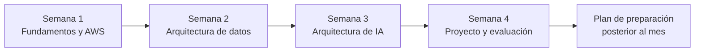
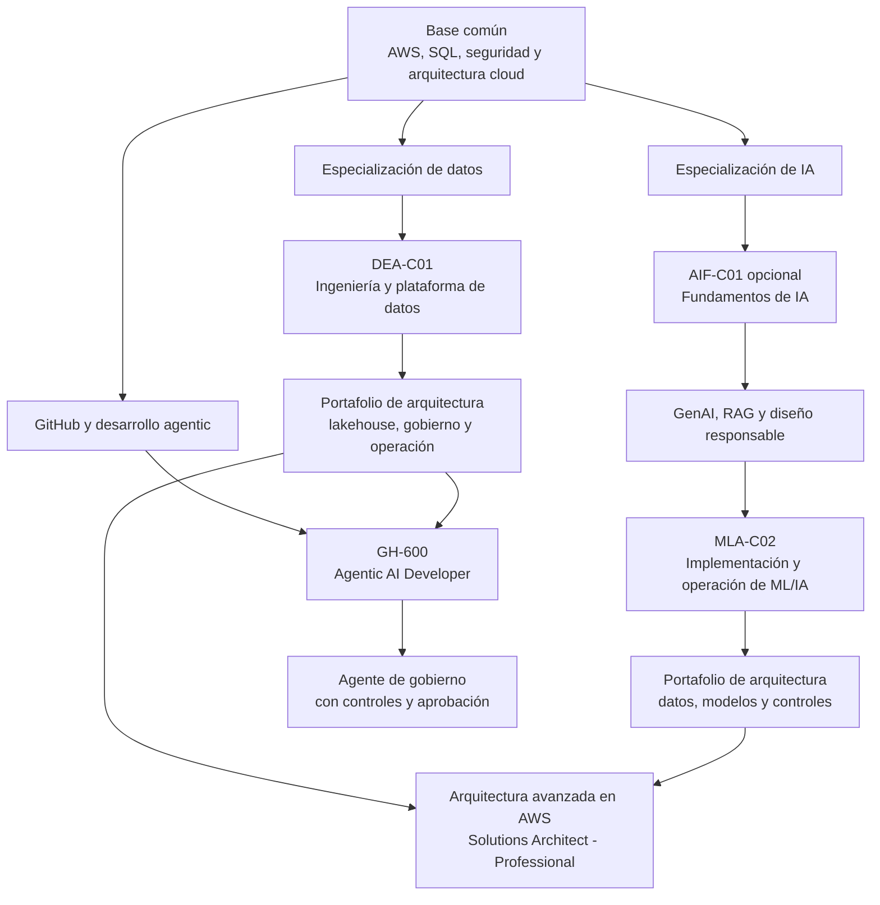
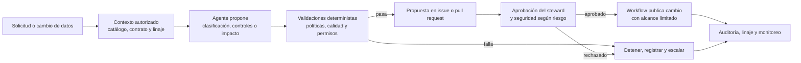

# Roadmap: Arquitectura de Datos e IA

> **Ruta de especialización con enfoque AWS + GitHub**  
> Plan de aprendizaje para aprovechar durante un mes las licencias de Udemy Enterprise, Percipio y Pluralsight. Complementa el **[resumen del curso base](./BigDataFoundations-Course-Summary.md)** e integra la meta **GH-600: GitHub Certified: Agentic AI Developer** para aplicar agentes a procesos de gobierno de datos. El material original del curso no se incluye en este repositorio.

| Parámetro | Plan |
|---|---|
| **Duración intensiva** | 4 semanas |
| **Dedicación sugerida** | 15 horas por semana; 60 horas en total |
| **Enfoque** | Fundamentos transferibles + AWS para datos/IA + GitHub para flujos agentic |
| **Resultado del mes** | Proyecto integrador de gobierno agentic, mapa de brechas y preparación inicial para certificaciones |
| **Importante** | Un mes es adecuado para intensificar el aprendizaje; no garantiza dominio profesional ni aprobar varias certificaciones. |

## Contenido

- [Objetivo y perfil del rol](#objetivo-y-perfil-del-rol)
- [Plan intensivo de cuatro semanas](#plan-intensivo-de-cuatro-semanas)
- [Cursos y uso de las licencias](#cursos-y-uso-de-las-licencias)
- [Ruta de certificaciones](#ruta-de-certificaciones-aws-y-github)
- [Ruta de desarrollo a largo plazo](#ruta-paso-a-paso-hacia-el-rol)
- [Proyecto integrador y lista de comprobación](#proyecto-integrador-sugerido)
- [Fuentes oficiales](#fuentes-y-notas)
- [Resumen del curso](./BigDataFoundations-Course-Summary.md)

## Objetivo y perfil del rol

El Arquitecto de Datos diseña cómo se recopilan, almacenan, transforman, gobiernan y consumen los datos de una organización. Su trabajo conecta las necesidades del negocio con decisiones técnicas sostenibles: confiabilidad, seguridad, escalabilidad, costo, interoperabilidad y facilidad de evolución.

No es únicamente quien selecciona herramientas o dibuja diagramas. Debe entender los datos y sus consumidores, hacer explícitos los trade-offs, definir estándares y ayudar a los equipos a implementar y operar la arquitectura.

## Plan intensivo de cuatro semanas

El plan supone **3 horas diarias, 5 días por semana**. Ajusta las horas según tu disponibilidad, pero conserva los entregables y el orden: primero fundamentos y datos; luego plataforma y confiabilidad; después IA; al final, integrar y evaluar. Si ya dominas una materia, usa su tiempo para el proyecto y las preguntas de práctica.

| Semana | Enfoque y actividades | Entregable verificable |
|---|---|---|
| **1 — Fundamentos y diagnóstico** | Estudiar el [resumen del curso](./BigDataFoundations-Course-Summary.md) y complementar con el curso original disponible en Pluralsight. Reforzar SQL, modelado, conceptos de AWS (IAM, S3, cómputo, redes y costos). Realizar diagnóstico de conocimientos para DEA-C01 y revisar sus dominios oficiales. | Mapa de brechas y diagrama de contexto de un caso de negocio. |
| **2 — Arquitectura e ingeniería de datos** | Estudiar ingestión, batch/CDC/streaming, ELT, lake/warehouse/lakehouse, formatos, catálogo, seguridad, calidad, orquestación y observabilidad. Hacer una pequeña carga de datos en AWS o un diseño equivalente si no se dispone de cuenta. | Diagrama de plataforma AWS, modelo de datos y contrato con controles de calidad. |
| **3 — Arquitectura de IA y agentes** | Reforzar fundamentos de IA/ML, servicios de IA generativa en AWS, elección de modelos, RAG, embeddings, búsqueda vectorial, evaluación, seguridad y costo. Estudiar conceptos GH-600 en el material oficial vigente: diseño de agentes, herramientas, contexto, flujos agentic en GitHub, evaluación y controles. Aplicarlos a clasificación y revisión asistida de metadatos. | Diseño de agente de gobierno de datos con fuentes/contexto autorizados, herramientas de solo lectura, política de escalamiento y controles de aprobación. |
| **4 — Integración y preparación de certificación** | Completar el proyecto integrador, preparar ADRs y estimación de costos, realizar prácticas diagnósticas para DEA-C01 y GH-600 y revisar brechas. Hacer práctica de fundamentos de IA si se elige AIF-C01. Verificar estado/versión de GH-600 y no agendar por terminar el calendario: decidir según guía vigente, práctica y experiencia. | Portafolio con arquitectura de datos, flujo agentic de gobierno, pruebas, decisiones documentadas y plan realista de exámenes. |

### Distribución sugerida de las 15 horas semanales

- **6 horas:** cursos en video o rutas de aprendizaje.
- **6 horas:** laboratorio o proyecto práctico.
- **2 horas:** documentación, diagramas y notas de decisiones.
- **1 hora:** repaso activo y preguntas de práctica.

## Cursos y uso de las licencias

Los catálogos empresariales pueden variar según organización, región y fecha. Los títulos de búsqueda de esta tabla son **temas y frases sugeridas**, no una afirmación de que cada licencia incluya un curso específico. Antes de comenzar, verifica que el curso esté disponible, actualizado para el código de examen vigente y con ejercicios prácticos. Evita tomar cursos duplicados sobre el mismo tema.

| Licencia | Uso prioritario durante el mes | Buscar en el catálogo |
|---|---|---|
| **Pluralsight** | Completar primero el curso base que da contexto a toda la ruta y usar cursos breves para aclarar vacíos técnicos. | **Big Data Foundations: The Modern Data Ecosystem**; AWS data engineering; arquitectura de soluciones AWS; fundamentos de GenAI/RAG; GitHub Copilot, agentes y GitHub Actions. |
| **Udemy Enterprise** | Elegir un curso principal de preparación para DEA-C01 y un curso/labs práctico sobre GitHub Agentic AI. Si queda tiempo, módulos de Bedrock/RAG. Filtrar por actualización y validar los objetivos oficiales. | `AWS Certified Data Engineer Associate DEA-C01`; `GH-600 GitHub Certified Agentic AI Developer`; `GitHub Copilot agents`; `GitHub Agentic Workflows`; `Amazon Bedrock RAG hands-on`. |
| **Percipio** | Usar rutas cortas para fundamentos de cloud, arquitectura, seguridad, gobierno de datos y agentes de IA; útil para repasar en sesiones breves. | AWS Cloud Architecture; Data Engineering; Data Governance; Generative AI; Responsible AI; GitHub Copilot/agentic AI; preparación de certificaciones. |
| **AWS Skill Builder / documentación oficial** | Complementar las licencias con guías de examen y pretests oficiales disponibles; usar las páginas oficiales como autoridad para objetivos y cambios del examen. | Guías DEA-C01, AIF-C01 y MLA-C02 enlazadas en [Fuentes oficiales](#fuentes-y-notas). |
| **GitHub Learn / documentación GitHub** | Preparar GH-600 con la guía oficial vigente y practicar flujos agentic en un repositorio de prueba; comprobar la disponibilidad del examen en el portal oficial. | GH-600; GitHub Copilot; agentes personalizados; GitHub Actions; seguridad de workflows; Agentic Workflows, si aparece en el material vigente del examen. |

**Estrategia para aprovechar el mes:** durante los primeros dos días, revisa los catálogos de las tres licencias y selecciona como máximo un curso principal por área. Guarda una copia personal de notas, diagramas y ejercicios que las políticas de tu empresa permitan conservar; al terminar el mes, la licencia puede dejar de estar disponible. No descargues ni redistribuyas contenido protegido fuera de las condiciones de uso.

## Ruta de certificaciones AWS y GitHub

No existe una única certificación que convierta a alguien en Arquitecto de Datos o Arquitecto de IA. Las certificaciones validan objetivos delimitados; el criterio arquitectónico también requiere experiencia, decisiones justificadas, operación y proyectos demostrables.

### Itinerario recomendado

| Orden | Certificación | Aporte a la ruta | Prioridad |
|---|---|---|---|
| **1. Base opcional** | **AWS Certified AI Practitioner (AIF-C01)** | Fundamentos de IA/ML, GenAI, casos de uso, IA responsable y servicios AWS. Es introductoria; no valida la construcción ni arquitectura integral de soluciones. | Alta si comienzas desde cero en IA; omitir si ya tienes fundamentos sólidos. |
| **2. Datos** | **AWS Certified Data Engineer - Associate (DEA-C01)** | Ingesta y transformación, almacenamiento, operación de pipelines, calidad, seguridad y gobierno de datos. Es la certificación AWS más directamente relacionada con la ruta de datos de este plan. | **Prioridad principal para Arquitectura de Datos.** |
| **3. Arquitectura cloud** | **AWS Certified Solutions Architect - Associate** | Diseño de soluciones cloud, disponibilidad, seguridad, rendimiento y costo; aporta fundamentos de arquitectura AWS que complementan DEA-C01. | Recomendada si todavía no tienes experiencia/certificación de arquitectura AWS. |
| **4. ML e IA aplicada** | **AWS Certified Machine Learning Engineer - Associate (MLA-C02)** | Preparación de datos, desarrollo, despliegue, operación, monitoreo y seguridad de soluciones ML y foundation models. | Siguiente paso técnico para IA, después de fundamentos y práctica. |
| **5. Desarrollo agentic** | **GitHub Certified: Agentic AI Developer (GH-600)** | Meta solicitada para validar desarrollo de sistemas agentic con GitHub. Complementa la arquitectura de datos con prácticas para automatizar flujos; la certificación de developer no sustituye la experiencia de arquitectura ni el diseño de gobierno. | En paralelo al proyecto de gobierno agentic. Confirmar guía, estado (beta/disponibilidad), idioma y agenda oficial antes de inscribirse. |
| **6. Arquitectura avanzada** | **AWS Certified Solutions Architect - Professional** | Diseño avanzado de soluciones AWS complejas, con optimización de seguridad, costo y rendimiento. No es exclusiva de datos ni de IA. | Meta de largo plazo, una vez adquirida experiencia real diseñando y operando AWS. |

**Orden sugerido según el perfil:** si partes de fundamentos cloud limitados, estudia Solutions Architect - Associate en paralelo o antes de DEA-C01. Para priorizar datos, prepara DEA-C01 primero y después MLA-C02. Trabaja GH-600 junto con fundamentos de GitHub y un proyecto de agentes, después de adquirir fundamentos de datos y seguridad. AIF-C01 es opcional: valida fundamentos, no reemplaza una certificación técnica.

AWS no ofrece en esta ruta una credencial que por sí sola certifique el rol completo de **AI Architect**. MLA-C02 complementa la especialidad con habilidades de ingeniería/operación; el diseño integral se demuestra con experiencia, decisiones de arquitectura y un portafolio que incluya seguridad, evaluación, gobierno y costos.

GH-600 complementa esa ruta desde el desarrollo de agentes con GitHub. El objetivo profesional es combinar esa capacidad con arquitectura de datos: diseñar flujos agentic gobernados, acotados, auditables y supervisados, no conceder al agente autoridad ilimitada sobre políticas o datos de producción.

### GH-600 aplicado a gobierno de datos

Usa GH-600 como una meta de desarrollo agentic y practica con un proceso de gobierno concreto. Un primer agente puede leer solicitudes, catálogo, glosario, contratos y linaje para preparar recomendaciones sobre clasificación, calidad, documentación o impacto de cambios. Debe presentar evidencia y abrir una propuesta revisable; no tomar decisiones sensibles de forma autónoma.

**Principios de diseño para agentes de gobierno**

- **Privilegio mínimo:** separar lectura de escritura; el agente comienza con acceso de solo lectura y a fuentes aprobadas.
- **Aprobación humana:** exigir revisión del data owner/steward y de seguridad para cambios de clasificación, acceso, retención o publicación.
- **Reglas deterministas para controles obligatorios:** usar políticas y pruebas explícitas para decidir si una acción está permitida; el modelo puede resumir evidencia o recomendar, no reemplazar el control.
- **Trazabilidad:** registrar solicitud, identidad del agente, fuentes consultadas, versión del prompt/política, validaciones, aprobaciones y resultado.
- **Fallos seguros:** ante datos incompletos, baja confianza, conflicto de políticas o fallo de herramientas, no efectuar cambios; escalar con contexto.
- **Alcance acotado:** no permitir que un agente elimine datos, altere permisos de producción o cambie políticas sin el proceso de aprobación y rollback definido.

El primer caso de uso recomendado es **asistir la documentación y clasificación de activos**, generando una propuesta con referencias a su evidencia y dejando la decisión final al steward. Después pueden explorarse validación de contratos, análisis de impacto de esquemas y triage de incidentes de calidad. Evalúa exactitud, falsos positivos, tiempo ahorrado y tasa de aprobación humana antes de automatizar más.

### Alcance y expectativas de examen

- La guía oficial de **DEA-C01** recomienda experiencia previa significativa en ingeniería de datos y AWS. El examen valida implementación, operación, seguridad y optimización de pipelines; no equivale por sí solo a la función completa de arquitecto.
- **MLA-C02** valida ingeniería y operación de ML/IA, incluidos foundation models. Su guía indica que diseñar arquitecturas integrales de ML/IA queda fuera del alcance del examen; úsalo como complemento técnico, no como una credencial de “AI Architect”.
- **AIF-C01** cubre comprensión fundamental y casos de uso; no evalúa crear modelos, pipelines ni arquitecturas de IA.
- Para **GH-600**, usa el material oficial asociado al código de examen y confirma que la convocatoria y el blueprint estén vigentes. La página oficial de GitHub Copilot que se pudo verificar en Microsoft Learn corresponde a **GH-300**, una certificación distinta; no usarla como sustituto de la guía GH-600.
- Usa siempre el código de examen y la guía vigente al comprar un curso o agendar. AWS actualiza sus exámenes y materiales; no se recomienda preparar una versión retirada.
- En el mes intensivo, el objetivo realista es establecer base y decidir el primer examen. No asumas que las 60 horas bastan para aprobar certificaciones de nivel Associate/Professional sin experiencia previa.

**Aviso de vigencia (14 de octubre de 2026):** la información oficial de AWS anuncia la actualización de Machine Learning Engineer - Associate a **MLA-C02**; verifica el estado de disponibilidad y el material de preparación antes de inscribirte, especialmente si un curso aún enseña MLA-C01. AWS también indica que la actualización de Solutions Architect - Professional abrirá registro para **SAP-C03** el 27 de octubre de 2026 y que el último día para rendir **SAP-C02** será el 16 de noviembre de 2026. Confirma fechas, idioma y disponibilidad en la página oficial antes de pagar o agendar.

## Ruta paso a paso hacia el rol

La duración depende de la experiencia previa. Avanza cuando puedas demostrar el resultado de cada etapa, en lugar de medir el progreso únicamente por cursos o certificaciones.

### Paso 1: Entender el negocio y los fundamentos de datos

- Aprende a traducir objetivos de negocio en preguntas, indicadores, consumidores y requisitos de frescura.
- Refuerza SQL, modelado relacional, normalización, dimensiones, hechos y fundamentos de almacenamiento.
- Distingue datos operacionales de datos analíticos.
- **Práctica:** documenta las entidades, fuentes, definiciones y métricas de un caso de negocio.
- **Resultado:** glosario inicial y modelo conceptual/lógico con supuestos explícitos.

### Paso 2: Construir bases de ingeniería de datos

- Practica SQL y un lenguaje de programación para transformar datos.
- Aprende formatos tabulares y columnares, particionamiento, cargas incrementales, CDC y conceptos de streaming.
- Desarrolla pipelines reproducibles, idempotentes y versionados.
- **Práctica:** ingiere datos de varias fuentes, conserva el original y prepara capas bronze/silver/gold.
- **Resultado:** pipeline ejecutable de extremo a extremo con validaciones automatizadas.

### Paso 3: Dominar arquitectura analítica moderna

- Compara lake, warehouse y lakehouse en función de requisitos; comprende ELT y separación de cómputo/almacenamiento.
- Explora un motor SQL, un motor de procesamiento distribuido y una herramienta de orquestación. Aprende principios transferibles antes de profundizar en un proveedor.
- Evalúa rendimiento, concurrencia, latencia, disponibilidad, interoperabilidad y recuperación.
- **Práctica:** implementa una carga analítica en batch y diseña qué cambiaría para CDC o streaming.
- **Resultado:** diagrama de arquitectura con flujos, componentes y razones de selección.

### Paso 4: Hacer la plataforma operable y confiable

- Define contratos, pruebas de esquema y reglas de calidad adecuadas al negocio.
- Añade dependencias, reintentos, alertas, SLAs/SLOs y gestión de fallos.
- Implementa métricas de frescura, volumen, distribución, esquema y linaje.
- **Práctica:** simula retrasos, duplicados y cambios incompatibles de esquema; verifica detección y recuperación.
- **Resultado:** plan de operación con alertas, responsables, impacto y procedimientos de recuperación.

### Paso 5: Incorporar seguridad, gobierno y costo desde el diseño

- Clasifica datos y define propiedad, acceso de mínimo privilegio, retención y trazabilidad.
- Considera cifrado, requisitos regulatorios, linaje y controles por sensibilidad.
- Estima costos de almacenamiento, cómputo, transferencias y operación; añade presupuestos y alertas.
- **Práctica:** revisa quién puede acceder a cada conjunto de datos y qué evidencia permite auditarlo.
- **Resultado:** matriz de accesos, decisiones de retención y estimación de costos con supuestos.

### Paso 6: Aprender a tomar y comunicar decisiones de arquitectura

- Compara alternativas administradas, abiertas e híbridas según velocidad, costo total, habilidades, portabilidad y dependencia de proveedor.
- Decide dónde centralizar estándares y dónde permitir autonomía de dominio.
- Registra decisiones, alternativas descartadas, riesgos, restricciones y consecuencias.
- **Práctica:** redacta un ADR (registro de decisión de arquitectura) para una decisión real del proyecto.
- **Resultado:** propuesta revisable por ingeniería, seguridad, operaciones y negocio, con diagramas y trade-offs claros.

### Paso 7: Extender la plataforma hacia ML e IA cuando exista el caso

- Comprende los requisitos de datasets para ML/IA, búsqueda vectorial, RAG y capas semánticas.
- Extiende gobierno, evaluación, linaje y control de costos a los nuevos consumidores.
- **Práctica:** diseña un caso RAG con fuentes autorizadas, recuperación trazable y respuestas basadas en contexto.
- **Resultado:** diseño que explica límites, protección de datos y cómo medir calidad; no solo selección de una base vectorial.

### Paso 8: Desarrollar agentes para procesos de gobierno

- Estudia el blueprint vigente de GH-600, GitHub Copilot y las capacidades agentic que el examen incluya; practica en un repositorio aislado.
- Modela una tarea concreta, el contexto permitido, las herramientas disponibles, el estado del flujo, los límites de autonomía y las condiciones de escalamiento.
- Trata las recomendaciones del agente como propuestas: valida con reglas deterministas y requiere aprobación humana para cambios sensibles.
- **Práctica:** automatiza la revisión de metadatos de un dataset y genera un issue o pull request con clasificación sugerida, calidad esperada, linaje consultado, evidencias y validaciones.
- **Resultado:** workflow reproducible y auditable que reduce trabajo manual sin otorgar permisos autónomos de producción al agente.

## Proyecto integrador sugerido

Diseña una plataforma para un negocio minorista que combine ventas de tiendas, pedidos digitales e inventario. El diseño debería responder:

1. ¿Qué fuentes se ingieren por batch, CDC o streaming y con qué frescura?
2. ¿Dónde se preservan los datos originales y cómo se reprocesan?
3. ¿Qué entidades, contratos, controles de calidad y capas bronze/silver/gold se necesitan?
4. ¿Qué patrón de almacenamiento y motores sirven a BI, analítica y ML?
5. ¿Cómo se orquestan los flujos y se detectan datos retrasados, incompletos o alterados?
6. ¿Quién es dueño de cada producto de datos y cómo se gobiernan accesos y definiciones?
7. ¿Cuáles son los costos, riesgos de dependencia, límites y alternativas?
8. ¿Qué proceso de gobierno conviene asistir con un agente, qué fuentes/herramientas puede consultar y qué acciones exigen aprobación humana?
9. ¿Cómo se evalúan las recomendaciones del agente, se registran sus decisiones y se revierte un cambio erróneo?

**Entregables:** diagrama de contexto y flujo de datos, modelo de datos, contratos, matriz de decisiones, controles de seguridad/calidad, estimación de costos, ADR y un diagrama/workflow del agente con permisos, pruebas, evidencia, aprobaciones, auditoría y rollback. Incluye supuestos, requisitos no funcionales y riesgos; un diagrama sin estas decisiones no es una arquitectura completa.

## Lista de comprobación del Arquitecto de Datos

- [ ] Los requisitos de negocio, usuarios y métricas están definidos.
- [ ] Las fuentes, flujos y contratos de datos están documentados.
- [ ] La elección de lake, warehouse o lakehouse responde a requisitos explícitos.
- [ ] Los pipelines soportan reintentos, validaciones y recuperación.
- [ ] Se observan frescura, volumen, distribución, esquema y linaje.
- [ ] Seguridad, propiedad, acceso y retención están considerados desde el diseño.
- [ ] Costos, operación, portabilidad y dependencia del proveedor son visibles.
- [ ] Las decisiones y sus trade-offs son comprensibles para equipos técnicos y de negocio.
- [ ] Los consumidores de analítica e IA reciben datos confiables y definiciones consistentes.
- [ ] El agente de gobierno tiene propósito y contexto acotados, permisos mínimos y límites de acción.
- [ ] Las acciones sensibles requieren aprobación humana y quedan registradas con evidencia.
- [ ] Hay validaciones deterministas, evaluación de calidad y un mecanismo de rollback para cambios agentic.

## Cómo usar esta guía

1. Estudia primero el [resumen del curso](./BigDataFoundations-Course-Summary.md) y complementa con el curso original en Pluralsight cuando quieras profundizar.
2. Completa las etapas en orden flexible, demostrando resultados con proyectos.
3. Revisa la lista de comprobación en cada decisión importante.
4. Usa este roadmap para organizar las certificaciones objetivo y el proyecto de gobierno agentic.

## Fuentes y notas

El contenido resumido del curso está en **[BigDataFoundations-Course-Summary.md](./BigDataFoundations-Course-Summary.md)**. La transcripción y el material original del curso no se publican en este repositorio; consulta el curso en Pluralsight. Los nombres, alcances y cambios de certificación se deben validar en AWS, que es la fuente de verdad para elegibilidad, objetivos, idiomas, fechas, precios y versiones del examen:

- [AWS Certified Data Engineer - Associate](https://aws.amazon.com/certification/certified-data-engineer-associate/) y su [guía oficial DEA-C01](https://docs.aws.amazon.com/aws-certification/latest/data-engineer-associate-01/data-engineer-associate-01.html).
- [AWS Certified AI Practitioner](https://aws.amazon.com/certification/certified-ai-practitioner/) y su [guía oficial AIF-C01](https://docs.aws.amazon.com/aws-certification/latest/ai-practitioner-01/ai-practitioner-01.html).
- [AWS Certified Machine Learning Engineer - Associate](https://aws.amazon.com/certification/certified-machine-learning-engineer-associate/) y su [guía oficial MLA-C02](https://docs.aws.amazon.com/aws-certification/latest/machine-learning-engineer-associate-02/machine-learning-engineer-associate-02.html).
- [AWS Certified Solutions Architect - Associate](https://aws.amazon.com/certification/certified-solutions-architect-associate/).
- [AWS Certified Solutions Architect - Professional](https://aws.amazon.com/certification/certified-solutions-architect-professional/).
- [Catálogo general de AWS Certification](https://aws.amazon.com/certification/).

Para GitHub, consulta [GitHub Learn](https://learn.github.com/certifications) y el catálogo de certificaciones de [Microsoft Learn](https://learn.microsoft.com/en-us/credentials/browse/?products=github&credential_types=certification). La ficha oficial de GitHub Copilot disponible en Microsoft Learn corresponde a **GH-300**, no a GH-600; son certificaciones diferentes. La información oficial pública consultada no permite confirmar en esta guía el estado de inscripción, versión, idiomas o blueprint detallado de **GH-600**. Antes de adquirir un curso o agendarlo, comprueba que GH-600 figure en el portal oficial y usa su guía de examen vigente; si se ofrece como beta, confirma sus condiciones y fecha.

Los cursos concretos disponibles en Udemy Enterprise, Percipio y Pluralsight dependen de las licencias institucionales. Comprueba el acceso desde tus catálogos y selecciona material alineado a la guía de examen vigente; esta guía no afirma que dichos cursos formen parte de un catálogo específico.
